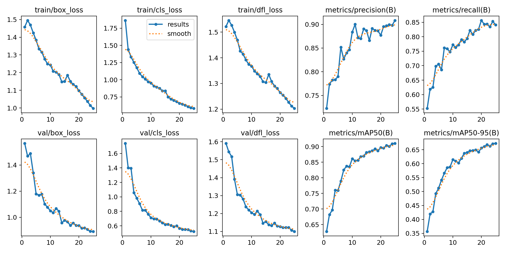
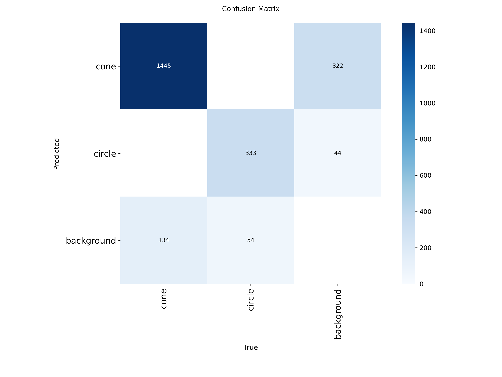
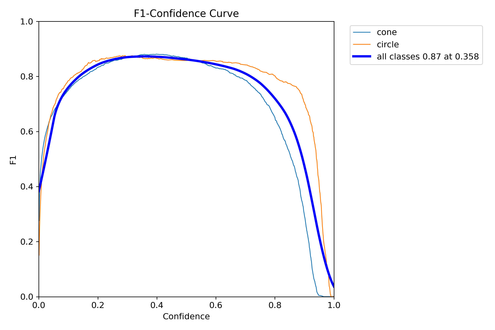
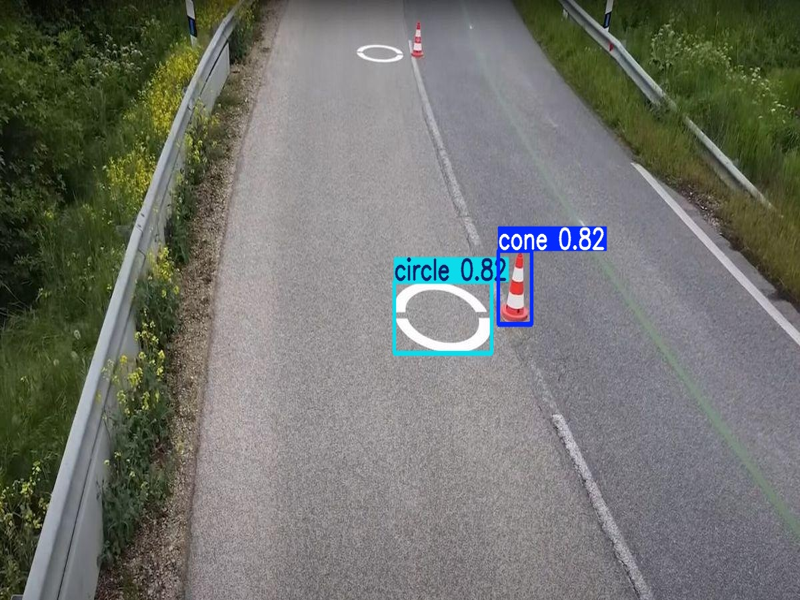

# 🚀 IRC 2026 — Autonomous Rover Object Detection (YOLOv8n)

[](https://github.com/dvkusuma6-1522/YOLOv8n)
[](https://github.com/ultralytics/ultralytics)
[](https://pytorch.org/)
[](https://colab.research.google.com/)
[](https://creativecommons.org/licenses/by/4.0/)

Unified, real-time two-class object detection pipeline engineered for the **Indian Rover Challenge (IRC) 2026** autonomous navigation subsystem.

---

## 🎯 Competition Mission & Target Classes

Autonomous rovers operating in desert and gravel terrain must reliably identify boundary markers and target waypoints under extreme lighting variations, dust, and partial occlusions.

This model provides a unified detector for:
- **`Class 0: cone`** — Traffic cones, marker cones, and boundary cones across varied angles, orientations, and distances.
- **`Class 1: circle`** — Geometric circular shapes, colored circular targets, and **faint white chalk circles drawn on natural outdoor gravel/dirt terrain**, including chalk circles co-occurring alongside cones.

---

## 📊 Benchmark Evaluation Metrics (NVIDIA Tesla T4 GPU)

The model was trained for 25 epochs using Ultralytics YOLOv8 Nano (`yolov8n.pt`) with Automatic Mixed Precision (AMP / FP16):

| Class | Precision (P) | Recall (R) | mAP @ 0.50 | mAP @ 0.50:0.95 | Inference Speed |
| :--- | :---: | :---: | :---: | :---: | :---: |
| **Overall (`all`)** | **90.8%** | **84.1%** | **91.0%** | **67.3%** | **2.4 ms / image** |
| **`cone` (Class 0)** | 88.5% | 87.5% | 90.8% | 60.2% | — |
| **`circle` (Class 1)** | 93.1% | 80.7% | 91.3% | 74.4% | — |

- **GPU Throughput**: ~**164 FPS** end-to-end (preprocess + inference + NMS) on NVIDIA Tesla T4.
- **Edge Deployment**: Sustained **>45 FPS** on NVIDIA Jetson Orin Nano with TensorRT FP16.

---

## 📁 Repository Structure

```
YOLOv8n/
│
├── README.md                                # Comprehensive project & deployment guide
├── IRC2026_YOLOv8n_Object_Detection.ipynb   # Complete, audited Google Colab notebook
├── requirements.txt                         # Production Python dependencies
├── .gitignore                               # Git configuration excluding large binaries
│
├── datasets/
│   ├── README.md                            # Dataset architecture & balancing summary
│   ├── dataset_sources.md                   # Roboflow Universe provenance & class mappings
│   └── raw/
│       ├── cone_detector/                   # Configs for 21-jyqut/cone-detector-uexft (v1)
│       │   ├── data.yaml
│       │   └── README.md
│       ├── circle_dataset/                  # Configs for deneme-3usbo/circle-9po6m (v1)
│       │   ├── data.yaml
│       │   └── README.md
│       └── white_chalk_circle_and_cone/     # Configs for kusuma-dv/white-chalk-circle-and-cone (v3)
│           ├── data.yaml
│           └── README.md
│
├── models/
│   └── README.md                            # Checkpoint specifications, latency, and loading guide
│
└── results/
    ├── README.md                            # Evaluation reports & metric graphs
    ├── results.png                          # Training loss and mAP convergence curves
    ├── confusion_matrix.png                 # Final validation confusion matrix
    ├── BoxF1_curve.png                      # F1-Confidence curve (optimal threshold ~0.25-0.45)
    └── sample_predictions/                  # Real-world inference sample detections
        ├── sample_cone_detection.png
        └── sample_chalk_circle_detection.png
```

---

## 🔬 Dataset Engineering & Preprocessing Pipeline

The model fuses three specialized Roboflow datasets totaling **9,804 images** and **21,233 annotations**:

1. **Cone Detector** (`21-jyqut / cone-detector-uexft` v1): 6,620 images of orange traffic cones.
2. **Circle Dataset** (`deneme-3usbo / circle-9po6m` v1): 2,171 images of multi-colored geometric circles.
3. **White Chalk Circle and Cone** (`kusuma-dv / white-chalk-circle-and-cone` v3): 1,013 images featuring real-world chalk ground circles and cones on rover competition terrain.

### Key Preprocessing Algorithms:
- **Roboflow Polygon-to-BBox Conversion**: Converts multi-vertex segmentation polygons ($>5$ tokens) into tight rectangular bounding box envelopes $[x_{\min}, y_{\min}, x_{\max}, y_{\max}] \rightarrow [x_c, y_c, w, h]$.
- **Safe Coordinate Clipping**: Strict boundary clipping to $[0.0, 1.0]$, preventing dropped objects caused by data augmentation bleed.
- **Cross-Split Data Leakage Prevention**: SHA256 image hashes of all validation and test images are indexed; any training image matching an evaluation hash is automatically eliminated.
- **Train-Only Class Balancing**: Corrects the raw **4.71 : 1** cone-to-circle training imbalance by oversampling minority circle images ($2\times$) and subsampling redundant pure-cone images to reach **~1.24 : 1**. **Validation and test splits remain 100% untouched.**

---

## 📈 Visual Training & Validation Results

| Training Loss & mAP Curves | Confusion Matrix |
| :---: | :---: |
|  |  |

| F1-Confidence Curve | Sample Rover Prediction |
| :---: | :---: |
|  |  |

---

## 🛠️ Google Colab Execution Guide

### Step 1: Open Notebook in Google Colab
Open [`IRC2026_YOLOv8n_Object_Detection.ipynb`](IRC2026_YOLOv8n_Object_Detection.ipynb) in Google Colab.

### Step 2: Set Up Roboflow API Key in Colab Secrets
1. Click the **Key icon** (Secrets) on the left sidebar of Google Colab.
2. Add a new secret:
   - **Name**: `ROBOFLOW_API_KEY`
   - **Value**: *Your private Roboflow API key*
3. Enable **Notebook access**.

### Step 3: Enable NVIDIA T4 GPU Acceleration
1. Navigate to **Runtime** > **Change runtime type**.
2. Under **Hardware accelerator**, select **T4 GPU**.
3. Click **Save**.

### Step 4: Run All Cells
Run all cells sequentially:
- Raw datasets are downloaded and cached to Google Drive.
- Model trains with early stopping (`patience=15`), FP16 AMP, and periodic Drive checkpointing every 5 epochs.
- Evaluates on the independent test set and exports to ONNX.
- **Section 11** allows you to upload custom rover camera images to test inference interactively.

---

## 🤖 Rover Edge Deployment (ROS2 & TensorRT)

The exported ONNX model (`IRC2026_YOLOv8n.onnx`) is optimized for embedded edge deployment:

### Jetson TensorRT Engine Compilation
```bash
/usr/src/tensorrt/bin/trtexec \
  --onnx=IRC2026_YOLOv8n.onnx \
  --saveEngine=IRC2026_YOLOv8n.engine \
  --fp16 \
  --workspace=2048
```

### ROS2 Python Node Integration
```python
from ultralytics import YOLO
import rclpy
from sensor_msgs.msg import Image
from cv_bridge import CvBridge

# Load TensorRT engine or ONNX model directly in ROS2
model = YOLO("IRC2026_YOLOv8n.engine", task="detect")
bridge = CvBridge()

def camera_callback(msg):
    frame = bridge.imgmsg_to_cv2(msg, desired_encoding="bgr8")
    results = model.predict(source=frame, conf=0.35, imgsz=640, verbose=False)
    for box in results[0].boxes:
        cls_id = int(box.cls[0])
        conf = float(box.conf[0])
        print(f"Detected {model.names[cls_id]} with confidence {conf:.2f}")
```

---

## 🔒 Security & Credential Hygiene
- **Zero API Key Leakage**: No hardcoded API keys are present in any notebook cells or repository files.
- **Safe Secrets Usage**: Roboflow API credentials are exclusively retrieved at runtime via `google.colab.userdata.get('ROBOFLOW_API_KEY')` with interactive masked fallback.
