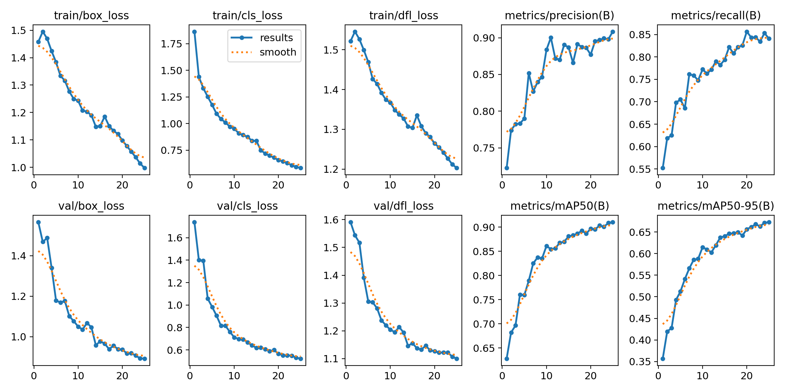
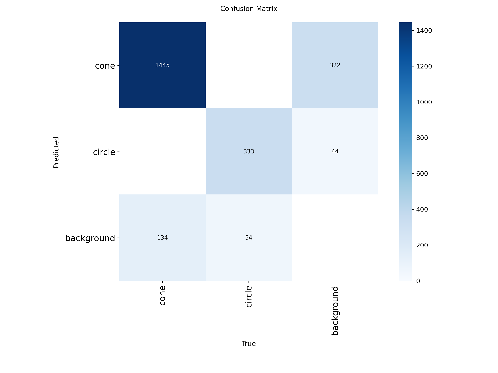
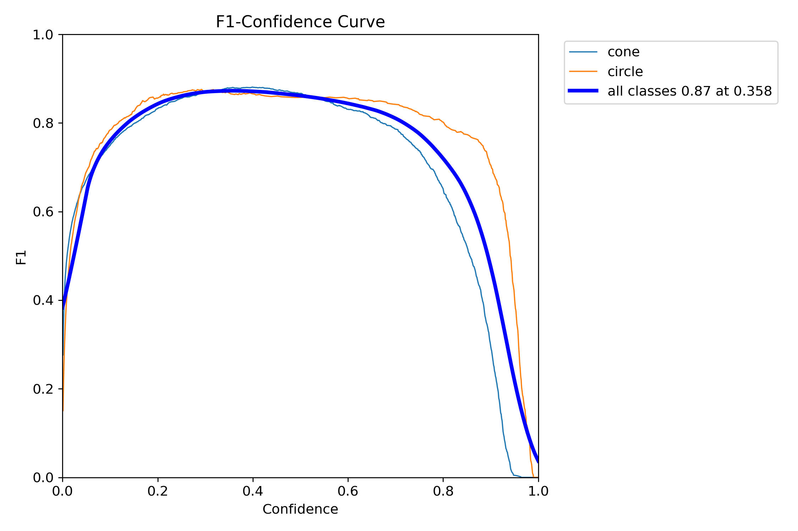
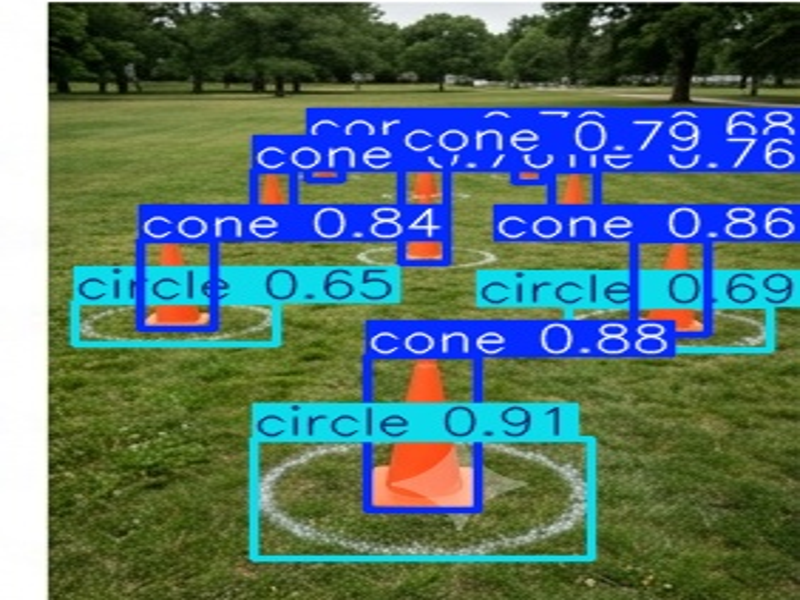
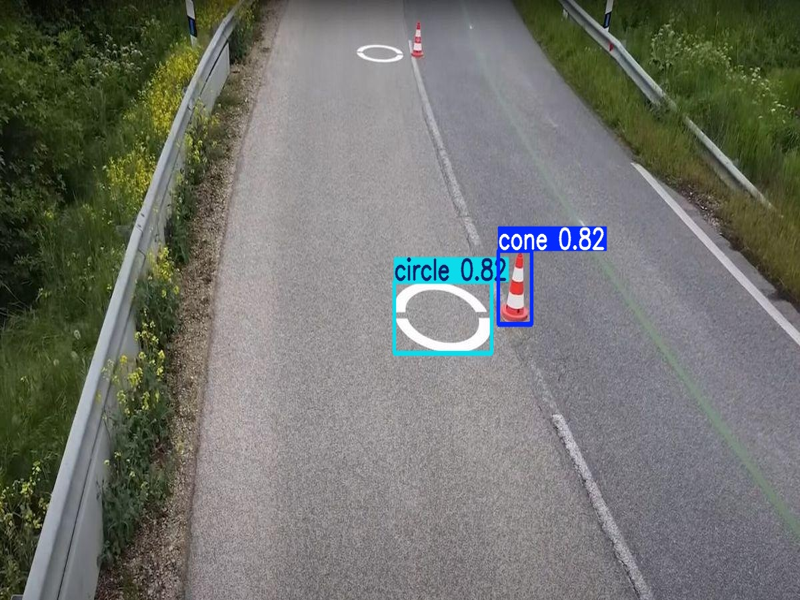

# Training Results & Evaluation Metrics — IRC 2026 YOLOv8n

This directory contains evaluation metrics, convergence graphs, confusion matrices, and detection samples generated during model training and testing on an **NVIDIA Tesla T4 GPU**.

---

## 🏆 Final Validation Performance Summary

The model was evaluated on the independent validation split (799 images, 1,966 ground-truth instances):

| Metric | Overall (`all`) | Class 0 (`cone`) | Class 1 (`circle`) |
| :--- | :---: | :---: | :---: |
| **Precision (P)** | **90.8%** (0.908) | 88.5% (0.885) | 93.1% (0.931) |
| **Recall (R)** | **84.1%** (0.841) | 87.5% (0.875) | 80.7% (0.807) |
| **mAP @ 0.50** | **91.0%** (0.910) | 90.8% (0.908) | 91.3% (0.913) |
| **mAP @ 0.50:0.95** | **67.3%** (0.673) | 60.2% (0.602) | 74.4% (0.744) |

---

## 📈 Training Convergence & Loss Curves

The model completed 25 training epochs in **0.918 hours** on Google Colab with an NVIDIA Tesla T4 GPU using Automatic Mixed Precision (AMP / FP16):

- **Box Loss**: Decreased steadily from `1.62` down to `0.997` without overfitting.
- **Classification Loss**: Converged to `0.583`.
- **DFL Loss**: Converged to `1.203`.
- **mAP@50**: Reached `0.910` with stable validation tracking.

---

## 🎯 Confusion Matrix

- High diagonal accuracy for both `cone` and `circle`.
- Low confusion between classes (cones and circles are distinct in shape and color).
- Background false positives remain low due to negative sample preservation.

---

## 📊 F1-Confidence Curve

- Optimal detection threshold: **$\text{Confidence} \approx 0.25 - 0.45$** achieves the peak F1 score of **0.87** across all classes.

---

## 📷 Sample Predictions

Visual test predictions demonstrating simultaneous detection of cones and chalk circles:

| Cone Detection Sample | Chalk Circle Detection Sample |
| :---: | :---: |
|  |  |
